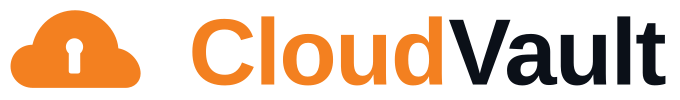

<p align="center">
  <picture>
    <source media="(prefers-color-scheme: dark)" srcset="public/brand/cloudvault-lockup-dark.svg">
    <source media="(prefers-color-scheme: light)" srcset="public/brand/cloudvault-lockup-light.svg">
    
  </picture>
</p>

<h1 align="center">CloudVault</h1>

<p align="center">
  <strong>Open-source private cloud storage for Cloudflare Workers + R2.</strong><br>
  Your own file vault at the edge — no server to maintain, no database to run.
</p>

<p align="center">
  <a href="https://github.com/zqs1qiwan/cloudvault/wiki">Documentation</a> ·
  <a href="https://github.com/zqs1qiwan/cloudvault/wiki/WebDAV">WebDAV</a> ·
  <a href="README.zh-CN.md">中文</a>
</p>

<p align="center">
  <code>v1.14.3</code> · <code>Cloudflare Workers</code> · <code>R2</code> · <code>MIT</code>
</p>

CloudVault is an open-source private cloud drive built on Cloudflare Workers and R2. The Worker serves the app, handles authentication, share links and WebDAV; R2 stores file bytes; KV stores accounts, site settings and the share signing key. Upload, organize and preview files, publish password-protected links or a guest folder, and mount the same vault on your desktop — with English and Chinese UI and light and dark themes.

## What you get

- **Files and folders** — drag-and-drop upload, nested folders, rename, move, delete, batch ZIP download.
- **Share links** — password protection, expiry dates, clean public URLs.
- **Guest access** — publish a folder to guests, with per-folder share exclusion.
- **WebDAV** — mount CloudVault as a network drive with rclone, Finder, Explorer or Cyberduck.
- **Previews** — images, video, audio, PDF, Markdown and code in the browser.
- **Two themes, two languages** — dark and light mode; English and Chinese with an instant switch.
- **Edge-native** — one Worker, one R2 bucket, one KV namespace; no VM or SQL database.
- **Private by default** — a single vault for your accounts, no public sign-up.
- **Your brand** — custom site name, logo and favicon from the admin settings.

## How it works

| Piece | Job |
| --- | --- |
| Cloudflare Worker | App, auth, share links, WebDAV |
| R2 | File bytes |
| KV | Accounts, site settings, share signing key |

## Security

- Passwords are hashed with PBKDF2; sessions use signed, HttpOnly cookies.
- Login attempts are rate-limited; share links can require a password and expire.
- `/admin` can sit behind Cloudflare Access if you want an extra gate.

## Deploy

**Requirements:** Node.js 20.19+, Wrangler 4+, a Cloudflare account with R2 enabled.

```bash
git clone https://github.com/zqs1qiwan/cloudvault.git
cd cloudvault
npm install
```

Create the two Cloudflare resources:

```bash
wrangler r2 bucket create cloudvault-files
wrangler kv namespace create VAULT_KV
```

Copy the config template and fill in your account ID and the KV namespace ID printed above:

```bash
cp wrangler.example.jsonc wrangler.jsonc
```

Deploy:

```bash
npm run deploy
```

Open the Workers URL. CloudVault redirects to `/setup`, where you create the first administrator account. The setup page closes automatically after that account exists.

No `ADMIN_PASSWORD` secret is required. `SESSION_SECRET` is optional: the share-link signing key is generated and stored in KV on first use.

## Use it

- Sign in at `/login`; the dashboard lives at `/admin`.
- Upload files by dragging them in, or use **Upload**. Create folders with **New Folder**.
- Right-click a file or folder to share, rename, move or delete it.
- Turn on **Enable Guest Page** in Settings to publish shared files at `/`.
- Share links look like `/s/<token>`, or a clean path such as `/TVBOX/app.apk`.
- WebDAV is available at `/dav/` using the same username and password as the web login.

Switch language with the **EN / 中文** button in the header. The choice is remembered on that device.

## Configuration

Site name, logo URL, guest access and the login button are managed in **Settings** inside the dashboard.

Accounts are managed under **Users**:

- `admin` — files, sharing, WebDAV, site settings and accounts.
- `user` — files, sharing and WebDAV.

Every account shares one vault. The last administrator cannot be demoted or deleted.

## Local development

```bash
npm run dev
```

Open `http://127.0.0.1:8787/setup` for first-run setup. No `.dev.vars` file is needed.

## Contributing

Issues and pull requests are welcome. Run the checks before opening a PR:

```bash
npm run check
```

## Links

- [Documentation and guides](https://github.com/zqs1qiwan/cloudvault/wiki)
- [Installation](https://github.com/zqs1qiwan/cloudvault/wiki/Installation)
- [WebDAV guide](https://github.com/zqs1qiwan/cloudvault/wiki/WebDAV)
- [FAQ](https://github.com/zqs1qiwan/cloudvault/wiki/FAQ)
- [Changelog](https://github.com/zqs1qiwan/cloudvault/wiki/Changelog)

Licensed under the [MIT License](LICENSE).
