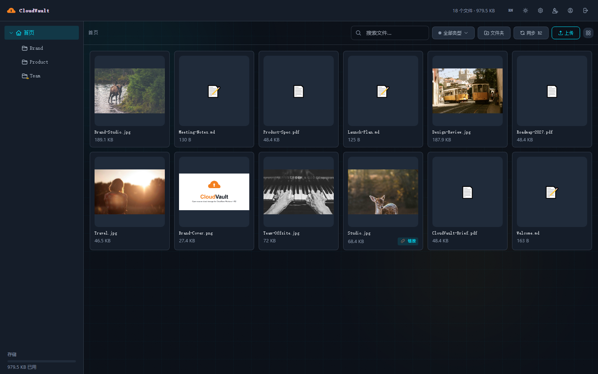
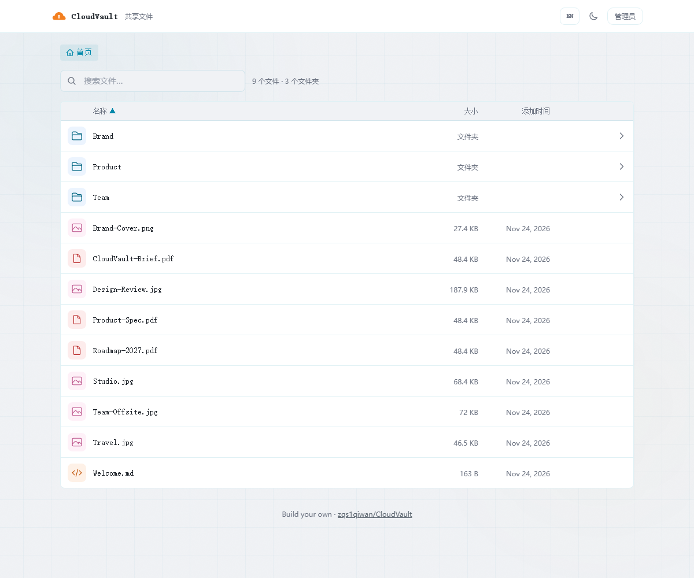
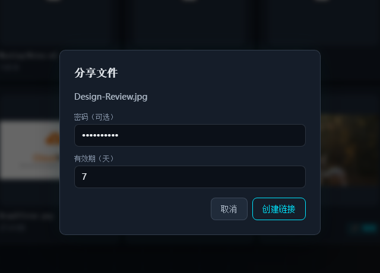
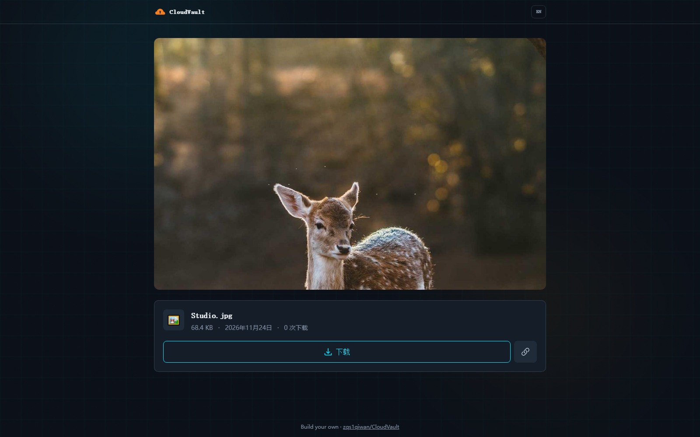

<p align="center">
  <picture>
    <source media="(prefers-color-scheme: dark)" srcset="public/brand/cloudvault-lockup-dark.svg">
    <source media="(prefers-color-scheme: light)" srcset="public/brand/cloudvault-lockup-light.svg">
    
  </picture><br>
  <strong>基于 Cloudflare Workers + R2 的开源私有云盘。</strong><br>
  把文件放在边缘节点，不用维护服务器，也不用运行数据库。
</p>

<p align="center">
  <a href="https://deploy.workers.cloudflare.com/?url=https://github.com/zqs1qiwan/cloudvault">
    
  </a><br>
  <a href="https://github.com/zqs1qiwan/cloudvault/tags">
    
  </a>
  &nbsp;
  <a href="https://github.com/zqs1qiwan/cloudvault">
    
  </a>
  &nbsp;
  <a href="LICENSE">
    
  </a>
  <br>
  
  <br>
  <a href="https://github.com/zqs1qiwan/cloudvault/wiki">使用文档</a> ·
  <a href="https://github.com/zqs1qiwan/cloudvault/wiki/WebDAV">WebDAV</a> ·
  <strong>简体中文</strong> ·
  <a href="README.en.md">English</a>
</p>

CloudVault 是一个跑在 Cloudflare Workers + R2 上的开源私有云盘。Worker 负责应用、登录、分享链接和 WebDAV，R2 存文件本体，KV 存账号、站点设置和分享签名密钥。支持上传、整理、在线预览，发布带密码的分享链接或访客目录，也能把同一个文件库通过 WebDAV 挂载到电脑；界面中英双语，支持深色和浅色主题。

## 界面预览

以下截图来自真实演示实例：文件管理、公开访问、分享设置与单文件分享页。

<p align="center">
  <a href="docs/screenshots/dashboard-zh.png"></a>
</p>
<p align="center"><strong>文件管理</strong> · 文件网格、文件夹树、上传与分享入口。</p>

<p align="center">
  <a href="docs/screenshots/guest-zh.png"></a>
</p>
<p align="center"><strong>公开分享页</strong> · 未登录即可浏览共享文件夹和公开文件。</p>

<p align="center">
  <a href="docs/screenshots/share-dialog-zh.png"></a>
</p>
<p align="center"><strong>分享设置</strong> · 为文件设置密码和有效期。</p>

<p align="center">
  <a href="docs/screenshots/share-page-zh.png"></a>
</p>
<p align="center"><strong>单文件分享页</strong> · 图片预览、下载与分享链接。</p>

## 高可用性

CloudVault 运行在 Cloudflare 的全球边缘网络上。基础设施可用性 **100% 继承 Cloudflare 的 SLA**，CloudVault 本身不额外承诺或降低这一标准：

- **Workers**：99.99% SLO，见 [Cloudflare Workers SLA](https://www.cloudflare.com/workers-service-level-agreement/)。
- **R2**：99.9% SLO，见 [Cloudflare R2 SLA](https://www.cloudflare.com/r2-service-level-agreement/)。
- **Business 及合约客户**：Cloudflare 合同中的 100% uptime SLA 同样适用，见 [Workers 计划](https://workers.cloudflare.com/plans)。

## 主要功能

- **文件与文件夹** —— 拖拽上传、多级文件夹、重命名、移动、删除、批量打包 ZIP 下载。
- **分享链接** —— 支持密码保护和有效期，公开地址简洁易读。
- **访客访问** —— 整个文件夹开放给访客，也可单独排除某个子文件夹。
- **WebDAV** —— 用 rclone、Finder、资源管理器或 Cyberduck 挂载为网络硬盘。
- **在线预览** —— 图片、视频、音频、PDF、Markdown 和代码直接在浏览器中打开。
- **双主题、双语言** —— 深色 / 浅色模式，中文 / 英文一键切换。
- **边缘原生** —— 一个 Worker、一个 R2 存储桶、一个 KV 命名空间；不需要虚拟机或 SQL 数据库。
- **默认私有** —— 所有账号共用一个文件库，没有公开注册入口。
- **品牌定制** —— 在后台修改站点名称、Logo 和站点图标。

## 工作原理

| 组件 | 职责 |
| --- | --- |
| Cloudflare Worker | 应用、登录、分享链接、WebDAV |
| R2 | 文件本体 |
| KV | 账号、站点设置、分享签名密钥 |

## 安全

- 密码使用 PBKDF2 哈希；会话使用签名后的 HttpOnly Cookie。
- 登录尝试有频率限制；分享链接可设置密码和有效期。
- 需要额外防护时，可以把 `/admin` 放在 Cloudflare Access 后面。

## 部署

### 一键部署

点击上方的 **Deploy to Cloudflare** 按钮。Cloudflare 会把仓库克隆到你的 GitHub 账号，自动创建 R2 存储桶和 KV 命名空间，并部署 Worker。完成后打开 `/setup` 创建第一个管理员账号。

### 手动部署

**环境要求：** Node.js 20.19+、Wrangler 4+、已开通 R2 的 Cloudflare 账号。

```bash
git clone https://github.com/zqs1qiwan/cloudvault.git
cd cloudvault
npm install
```

创建两个 Cloudflare 资源：

```bash
wrangler r2 bucket create cloudvault-files
wrangler kv namespace create VAULT_KV
```

复制配置模板，填入账号 ID 和上一步输出的 KV 命名空间 ID：

```bash
cp wrangler.example.jsonc wrangler.jsonc
```

部署：

```bash
npm run deploy
```

打开 Workers 域名后会自动跳转到 `/setup`，创建第一个管理员账号即可。账号创建成功后，该页面会自动失效。

不需要 `ADMIN_PASSWORD` 之类的部署密钥。`SESSION_SECRET` 也是可选的：分享链接的签名密钥会在首次使用时自动生成并存入 KV。

## 使用方法

- 在 `/login` 登录，后台地址是 `/admin`。
- 拖拽文件到窗口即可上传，也可以点击 **上传**；用 **新建文件夹** 创建目录。
- 右键文件或文件夹，可以分享、重命名、移动或删除。
- 在 **设置** 中开启 **启用访客页面**，共享文件就会出现在首页。
- 分享链接形如 `/s/<token>`，也支持 `/TVBOX/app.apk` 这样的简洁地址。
- WebDAV 地址为 `/dav/`，账号密码与网页登录相同。

点击页头右上角的 **EN / 中文** 即可切换语言，选择会保存在当前设备。

## 配置

站点名称、Logo 地址、访客页面和登录按钮都在后台的 **设置** 中管理。

账号在 **用户** 中管理：

- `admin` —— 文件、分享、WebDAV、站点设置和账号管理。
- `user` —— 文件、分享和 WebDAV。

所有账号共用一个文件库。最后一个管理员不能被降级或删除。

## 本地开发

```bash
npm run dev
```

打开 `http://127.0.0.1:8787/setup` 完成首次初始化。不需要 `.dev.vars` 文件。

## 参与贡献

欢迎提交 Issue 和 Pull Request。提交 PR 前请先运行：

```bash
npm run check
```

## 相关链接

- [使用文档](https://github.com/zqs1qiwan/cloudvault/wiki)
- [安装指南](https://github.com/zqs1qiwan/cloudvault/wiki/Installation)
- [WebDAV 指南](https://github.com/zqs1qiwan/cloudvault/wiki/WebDAV)
- [常见问题](https://github.com/zqs1qiwan/cloudvault/wiki/FAQ)
- [更新日志](https://github.com/zqs1qiwan/cloudvault/wiki/Changelog)

本项目采用 [MIT 许可证](LICENSE)。
